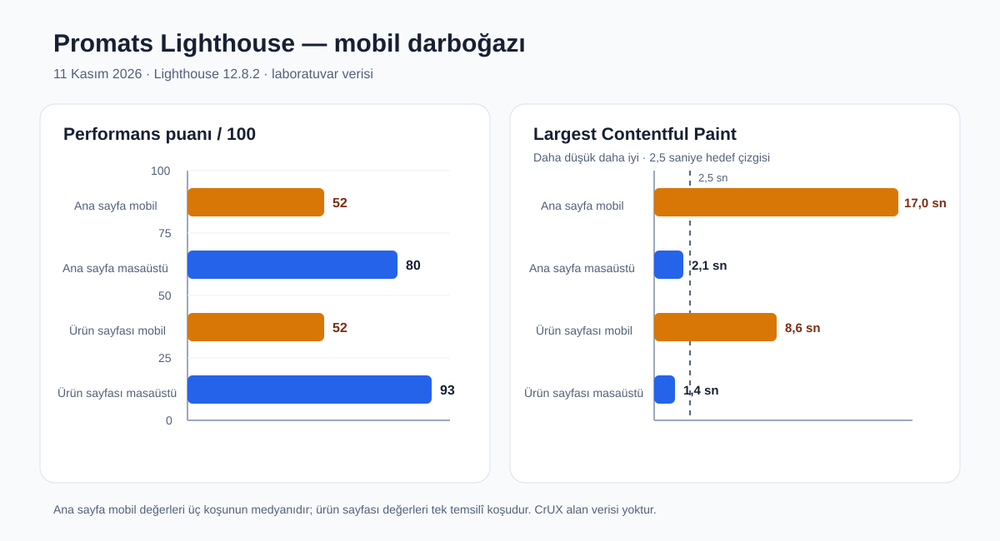

# Promats SEO, GEO ve Lighthouse Eksikler Raporu

**Tarih:** 11 Kasım 2026

**Kapsam:** `https://promats.com.tr` canlı sitesi, Promats kaynak kodu, Tanitio site denetimi, Search Console/GA4 özetleri ve yerel Lighthouse ölçümleri

**Amaç:** Hataları önem sırasına koymak, yanlış pozitifleri ayırmak ve her madde için doğrulanabilir çözüm/kabul ölçütü tanımlamak.

## İki dilli E-E-A-T ve SSS güncellemesi — release `8bd40d0`

11 Kasım'da ana sayfa, kurumsal, üretim, ürün listesi, 40 TR/EN ürün detayı, kaynak listesi ve iletişim sayfalarına sayfa amacına özel Türkçe/İngilizce SSS alanları eklendi. Görünür soru ve yanıtlarla aynı içeriği taşıyan `FAQPage` JSON-LD kullanıldı. Kurumsal içerik sahipliği “Yazar ve yayıncı: Promats” / “Author and publisher: Promats” olarak görünür ve şemada canonical Organization kimliğine bağlıdır. Ürün detaylarındaki mevcut ölçü ve ağırlıklar `Thing.additionalProperty` altında `PropertyValue` olarak yayımlandı; fiyat/teklif/yorum kanıtı olmayan seri sayfaları yeniden `Product` olarak işaretlenmedi.

Canlı sitemap'teki 40 ürün detayının tamamı düşük eşzamanlılıkla yeniden tarandı: **40/40 HTTP 200**, **40/40 üç görünür ve şemalı SSS**, **0 Product zorunlu alan riski**. Doğrulanmamış kişi uzmanı, müşteri yorumu, garanti, sertifika, ölçü veya tarih üretilmedi.

Tanitio v3 motorunun aynı 10 canonical sayfalık takip ölçümü:

| Ölçüm | Önceki canlı ölçüm | Release `8bd40d0` | Değişim |
|---|---:|---:|---:|
| SEO v3 | 64,5 | **69,4** | +4,9 |
| GEO | 46,4 | **50,6** | +4,2 |
| E-E-A-T | 53,4 | **65,4** | +12,0 |
| İçerik kalitesi | 21,8 | **29,8** | +8,0 |
| Başlık terimi tutarlılığı | 77,1 | **81,2** | +4,1 |
| İç linkler | 100 | **100** | Korundu |

E-E-A-T sinyal sonucu: görünür yazar/kurumsal yayıncı **10/10**, SSS **8/10**, Organization şeması **10/10**. İki kaynak makalesi kendi makale içeriğine özel yeni soru kanıtı olmadığı için genel SSS ile şişirilmedi. Kalan puan açıklığı gerçek müşteri yorumu/sosyal kanıt, doğrulanabilir güvence, sayfa-özel birimli ölçüm ve bağımsız otorite kaynağı gerektirir.

Yayın sonrası tek koşuluk Lighthouse regresyon kontrolü:

| Rota | Performans | Erişilebilirlik | En iyi uygulamalar | SEO |
|---|---:|---:|---:|---:|
| `/tr` | 99 | 98 | 100 | 100 |
| `/tr/urunler/maximum-serisi` | 99 | 100 | 100 | 100 |
| `/tr/hakkimizda` | 99 | 96 | 100 | 100 |
| `/tr/iletisim` | 97 | 97 | 100 | 100 |
| `/tr/arama` | 99 | 100 | 100 | 69 |
| `/en/products/orbital-series-4521350` | 100 | 100 | 100 | 100 |

`/tr/arama` skoru, doğru biçimde korunan `noindex` arama sonucu politikası nedeniyle 69'dur. Bu tablo performans medyanı değil, yayın sonrası tek koşuluk regresyon kontrolüdür. TR ve EN ürün SSS alanları ayrıca 1440 px masaüstü ve 390 px mobil gerçek tarayıcıda kontrol edildi; görünür taşma veya konsol hatası oluşmadı.

## Uygulama sonucu ve canlı kabul — 11 Kasım 2026

Bu rapordaki uygulanabilir kod, veri ve altyapı maddeleri tamamlanıp canlıya alındı. Son uygulama release'i `a7ad718`; sunucuda derleme yapılmadan yerel artifact ile atomik olarak etkinleştirildi. Aşağıdaki ilk “Yönetici özeti” bölümü artık başlangıç fotoğrafıdır.

### SEO v3 takip denetimi ve Lighthouse kabulü — release `a7ad718`

11 Kasım'da kullanıcının ilettiği SEO v3 raporuna karşı canlı site yeniden işlendi. Tanitio'nun aynı v3 hesaplama motoru 10 canonical sayfada yerelden çalıştırıldı; API erişimi salt okunur olduğu için bu sonuç panel veritabanına yeni denetim satırı olarak yazılmadı. Canlı çıktının yerel kanıtı `/tmp/promats-full-audit-a7ad718.json` dosyasındadır.

| Ölçüm | Bildirilen başlangıç | Son canlı ölçüm | Sonuç |
|---|---:|---:|---|
| SEO v3 | 63,0 | **64,5** | +1,5 puan |
| SEO kapsamı / güveni | %94 / %70,2 | **%94 / %70,2** | Aynı kapsam |
| GEO | önceki canlı takipte 45,1 | **46,4** | İyileşti |
| Bulgu sayısı | 6 | **3** | 3 bulgu kapandı |
| İç link puanı | 88,9 | **100** | Tamamlandı |
| Bağlantı almayan taranmış sayfa | 2 | **0** | Tamamlandı |
| E-E-A-T | 50,8 | **53,4** | İyileşti |
| Başlık terimi tutarlılığı | 72,4 | **77,1** | Bulgu eşiğinin üstüne çıktı |

Kapatılan rapor maddeleri:

- `/tr/hakkimizda` ve `/tr/uretim` dahil beş ana bölüme, sayfa gövdesinde görünen ve TR/EN eşleşen bir keşif/iç link alanı eklendi. Örneklemde bağlantısız taranmış sayfa kalmadı; beş ana bölümün her biri 9 örneklem iç bağlantısı aldı.
- Kapitone ürün başlığı 30–60 karakter aralığına getirildi; canlı başlık `KAPİTONE SERİSİ PVC Oto Paspas | Promats` oldu.
- Ana sayfa, kurumsal, üretim, ürün listesi, iletişim ve kaynak sayfaları için ayrı paylaşım görselleri kullanıldı; “6 sayfada aynı og:image” bulgusu kapandı.
- Makale şablonuna görünür kurumsal yazar/yayıncı ve tarih eklendi. Organization/WebSite şeması korunarak E-E-A-T 50,8'den 53,4'e çıktı.
- 20 aktif seri, 2017 kuruluş yılı, 3 standart renk seçeneği ve 35'ten fazla ihracat ülkesi gibi mevcut ve doğrulanmış şirket/katalog verileri; içerik üretim yöntemi ve teyit sınırıyla birlikte görünür yayın notuna dönüştürüldü. Yeni ölçümde içerik kalitesi skoru değişmedi; motor sayfa-özel birimli ölçüm, vaka veya özgün araştırma arıyor. Böyle bir veri mevcut kaynaklarda bulunmadığı için rakam/vaka uydurulmadı.

Kalan üç bulgu hata değil, doğrulanmış yeni kanıt gerektiren içerik fırsatıdır:

1. **İçerik kalitesi 21,8:** 10 sayfanın çoğunda Promats'a ait birimli test/ölçüm veya vaka kaydı yok. Gerçek test sonuçları olmadan bu skor güvenli biçimde yükseltilemez.
2. **E-E-A-T 53,4:** Motor özellikle kişi uzmanlığı, doğrulanmış yorum/güvence ve sayfa-özel deneyim kanıtı arıyor. Doğrulanmamış uzman, müşteri yorumu, garanti veya sertifika üretilmedi.
3. **Konusal otorite 69,6:** Ölçüm URL'nin ilk yol bölümünde en az 3 sayfayı “derin küme” sayıyor. Ürünler, products, kaynaklar ve resources kümeleri zaten derin; iletişim/üretim/hakkımızda gibi tek amaçlı sayfaları puan uğruna sahte alt sayfalara bölmek doğru değil.

Canlı HTTP yönlendirme bildirimi yanlış pozitif/stale çıktı: `http://promats.com.tr`, `http://www.promats.com.tr` ve path/query içeren örnekler yolu ve sorguyu koruyan tek **301** ile `https://promats.com.tr` non-www karşılığına gidiyor.

E-posta güvenliği canlı DNS kontrolünde ayrıştırıldı: SPF mevcut ve `v=spf1 include:_spf.trwww.com -all`; DMARC kaydı yok, denenen yaygın DKIM seçicileri yanıt vermiyor ve `mail.promats.com.tr` TLS sertifikası bu hostla eşleşmiyor. Turhost/cPanel DNS ve posta yönetim oturumu bu çalışma ortamında bulunmadığı için sağlayıcı tarafındaki bu üç değişiklik uygulanamadı; DKIM anahtarı veya DMARC rapor adresi uydurulmadı.

Son Lighthouse masaüstü kabulü beş canlı rotada tek koşu olarak alındı:

| Rota | Performans | Erişilebilirlik | En iyi uygulamalar | SEO | LCP | CLS |
|---|---:|---:|---:|---:|---:|---:|
| `/tr` | 99 | 100 | 100 | 100 | 776 ms | 0 |
| `/tr/urunler/maximum-serisi` | 98 | 100 | 100 | 100 | 936 ms | 0,006 |
| `/tr/hakkimizda` | 99 | 100 | 100 | 100 | 659 ms | 0 |
| `/tr/iletisim` | 73 | 100 | 100 | 100 | 2.676 ms | 0 |
| `/tr/arama` | 97 | 100 | 100 | 69 | 875 ms | 0 |

Arama sayfasının SEO puanı bilinçli `noindex, follow` nedeniyle 69'dur; site içi arama sonuçlarının indekslenmemesi doğru davranıştır. Eksik meta açıklaması eklendi. Önceki Lighthouse turunda görülen çerez bandı, ana sayfa filigranı ve sosyal etiket kontrastları giderildi; son turda beş rotanın erişilebilirlik puanı 100'dür.

### Sonuç özeti

| Alan | Başlangıç | Son canlı sonuç | Durum |
|---|---:|---:|---|
| Tanitio site sağlığı | 74–75 | **100/100**, crawl `#305`, 100/100 sayfa | Tamamlandı |
| Crawl error / warning grubu | 0 error, 262 warning | **0 error, 0 warning** | Tamamlandı |
| Product zorunlu şema alanı | 40 sayfa | **0 sayfa** | Tamamlandı |
| Ana sayfa mobil performans | 52 | **95 medyan** | Hedef geçti |
| Ana sayfa mobil LCP | 17,0 sn | **2,62 sn medyan** | Büyük ölçüde düzeldi; 2,5 sn laboratuvar hedefinin 0,12 sn üstünde |
| Ürün mobil performans | 52 | **93 medyan** | Hedef geçti |
| Ürün mobil LCP | 8,6 sn | **2,94 sn medyan** | Büyük ölçüde düzeldi; 2,5 sn laboratuvar hedefinin 0,44 sn üstünde |
| Ana sayfa aktarımı | 4,93 MiB | **0,78 MiB medyan** | Tamamlandı |
| Ürün aktarımı | 3,42 MiB | **0,68 MiB medyan** | Tamamlandı |
| CLS | ölçülmedi | ana sayfa **0**, ürün **0,021** | Hedef geçti |

Son Lighthouse kabul serisi üçer bağımsız mobil koşudur. Ana sayfa skorları `95 / 96 / 78`, ürün skorları `96 / 77 / 93`; tek iyi koşu seçilmemiş, medyan raporlanmıştır. LCP iki sayfada da başlangıca göre dramatik biçimde düştü, ancak katı `≤2,5 sn` laboratuvar kapısı medyanda henüz tam geçmedi. CrUX alan verisi bulunmadığı için bu durum gerçek kullanıcı Core Web Vitals sonucu olarak yorumlanmamalıdır.

### Maddelerin kapanış durumu

1. **Robots ve render kaynakları:** `/_next/` engeli kaldırıldı. Yeni taramalarda `robots_blocked_resources` ve `robots_blocked_images` yok.
2. **GEO/llms.txt:** Yalnız `promats.com.tr` public canonical URL'leri yayımlanıyor; `/promats` ve eski panel alan adı temizlendi. AI/GEO tarama skoru 100.
3. **GA4/GTM:** Property `563587381`, measurement ID `G-RF7H08PL6W` ve container `GTM-K6XBW5WK` standardize edildi. Analitik kod rıza verilmeden yüklenmiyor. Gerçek mobil tarayıcıda rıza sonrası `page_view` isteği `region1.google-analytics.com/g/collect` üzerinden **HTTP 204** aldı. GA4 Realtime/Data API henüz satır döndürmüyor; bu yeni mülkün Google tarafındaki işleme/zaman kapısıdır ve kodla zorlanamaz. Gerçek form/lead yalnız test için gönderilmedi.
4. **Lighthouse:** 219 raster varlık WebP'e çevrildi; görünür sayfalar optimize varyantları kullanıyor. Kaynak toplamı yaklaşık 41 MB'tan 5,5 MB'a indi. Icomoon 120 KB'tan 2,3 KB'a subset edildi; AOS ve Swiper etkileşime ertelendi; analitik rıza kapısına alındı; gereksiz dört webfont isteği ve görsel hydration sınırı kaldırıldı.
5. **Host tekilleştirme:** `www` tüm path/query değerlerini koruyan tek 301 ile non-www HTTPS'e gidiyor; kopya HTML sunulmuyor.
6. **Meta açıklamalar:** Benzersizleştirildi; crawl `#303` ile `duplicate_meta_description`, crawl `#304` ile `meta_description_too_long` kapandı.
7. **H1 yapısı:** Canonical sayfalarda tek H1 sağlandı; `h1_multiple` ve `duplicate_h1` kapandı.
8. **Hreflang:** TR/EN ürünleri veri sırasına göre doğru çiftlendi; self, reciprocal ve `x-default` tamamlandı. İlgili dört hreflang hata grubu kapandı.
9. **Şema ve sosyal paylaşım:** Organization/WebSite/Article graph'ları canonical kimlik, URL ve logo ile tamamlandı. `structured_data_missing_recommended` ve kullanıcının bildirdiği Product zorunlu alan grubu kapandı. Doğrulanmamış sosyal profil veya puan/yorum verisi uydurulmadı.
10. **Kısa başlık/ince içerik:** Temiz sayfa başlıkları ve açıklayıcı içerikler geliştirildi. Teklif query URL'leri ayrı içerik gibi şişirilmedi; `noindex,follow` + ana iletişim canonical'ı korundu. Crawl `#304` ile `title_too_short`, `#305` ile `low_word_count` kapandı.
11. **GEO/E-E-A-T:** Üretim, ürün, OEM, kaynak ve iletişim sayfalarına kaynak gösterilebilir açıklayıcı bloklar; makalelere kurumsal yayıncı/yazar bağlantıları eklendi. Kanıtsız sertifika, garanti veya kapasite iddiası eklenmedi.
12. **GSC:** Sitemap Google tarafından üç temsilî URL'de görüldü. 11 Kasım tarihli URL Inspection: `/tr` **Submitted and indexed**, robots **ALLOWED**, fetch **SUCCESSFUL**, Google/user canonical eşleşiyor. TR Badem ve EN Almond ürün URL'leri **Discovered - currently not indexed**; sitemap ve iç bağlantı keşfi mevcut. Google'ın daha sonra tarama/indeksleme kararı harici bir bekleme kapısıdır.

### Yeni tarama `#305`

- 100/100 sayfa, sağlık **100**, error **0**, warning **0**.
- Crawl `#304` sonrasında oluşan `metadata_in_body` bildirimi Next.js `htmlLimitedBots` politikasıyla kapatıldı. Canlı bot HTML'inde title, description ve canonical yalnız `<head>` içinde birer kez; `<body>` içinde sıfır.
- Kalan kayıtların tamamı notice: Next.js/RSC kaynaklı düşük text/HTML oranı; açıkça PDF olan katalog bağlantısı; 40 teklif query URL'sinin beklenen `noindex` + iletişim canonical/hreflang davranışı; bir `h1_equals_title`; HTML olmayan katalog PDF için crawler `page_fetch_failed`. PDF ayrıca HTTP 200, doğru MIME ve byte-range desteğiyle doğrulandı.

### Kalan dış kapılar

- GA4 Realtime ve ertesi-gün Data API satırının Google tarafında oluşması.
- GSC'de keşfedilmiş iki örnek ürün URL'sinin Google tarafından taranıp indekslenmesi.
- Katı Lighthouse LCP medyanının 2,5 sn altına indirilmesi; performans skoru, CLS ve aktarım hedefleri geçmiştir. Kalan gecikme ağırlıklı olarak legacy global CSS/render yolundadır ve sonraki adım tema CSS'ini rota bazında bölmektir.

## Yönetici özeti

Promats'ın 10 Kasım'daki son 100 sayfalık taramasında **kritik hata sayısı 40'tan 0'a**, sağlık puanı **62'den 74'e** çıktı. Kullanıcının ilettiği 40 ürün sayfasındaki `Product` şeması zorunlu alan hatası son taramada artık görünmüyor. Ancak site henüz temiz değil: **262 uyarı ve 430 bilgilendirme** kaydı var.

En önemli açıklar:

1. `robots.txt`, `/_next/` kaynaklarını 99 sayfada botlara kapatıyor. CSS/JS/görsel işlenebilirliğini ve denetim kalitesini doğrudan etkiliyor.
2. Canlı `llms.txt`, yanlışlıkla `https://promats.com.tr/promats` ve `panel.avrasyaotomotiv.net` kaynaklarını yayımlıyor; İngilizce anahtar sayfalarda da eski Türkçe yollar var. GEO için yanlış makine-okunur kaynak üretiliyor.
3. GA4 yapılandırılmış görünmesine rağmen son 28 günlük performans görünümünde **0 organik oturum, 0 GA4 sayfası ve 0 anahtar etkinlik** var. Ölçüm hattı doğrulanmadan dönüşüm optimizasyonu yapılamaz.
4. Mobil Lighthouse ana sayfa performansı üç koşuda **50–54 (medyan 52)**, LCP **14,2–17,6 sn (medyan 17,0 sn)**. Masaüstü medyanı 80 ve LCP 2,1 sn; sorun belirgin biçimde mobil varlık/işleme yükünde.
5. 57 sayfada aynı meta açıklama, 40 ürün sayfasında yinelenen/genel H1, ana sayfada birden fazla H1 ve çeşitli hreflang tutarsızlıkları bulunuyor.
6. `www.promats.com.tr`, ana alana yönlenmek yerine ayrı kopya site olarak açılıyor. Canonical sinyali olsa da host düzeyinde tekilleştirme eksik.
7. GEO denetimi **29,5/100**: ana sayfa Organization/brand grafiği, doğrulanmış sosyal profiller, kaynak gösterilebilir içerik blokları ve E-E-A-T kanıtları zayıf.

## Kanıtların kapsamı ve sınırları

- Tanitio crawl `#300`: 10 Kasım 2026, 100 sayfa, 0 hata / 262 uyarı / 430 notice.
- SEO/GEO tam denetimi: 10 Kasım 2026, 10 sayfalık örneklem; SEO 58,4, GEO 29,5. Bunlar sıralama garantisi değil, denetim motorunun öncelik göstergeleridir.
- Lighthouse 12.8.2: 11 Kasım 2026. Ana sayfada mobil ve masaüstü üçer koşu; ürün sayfasında temsilî tek koşu.
- CrUX gerçek kullanıcı alan verisi bulunmadı (`NOT_FOUND`). Bu nedenle Core Web Vitals sonucu değil, laboratuvar ölçümü raporlanır.
- GSC/GA4 görünümü: son 28 gün. GSC veri sağlıyor; GA4 organik oturum ve anahtar etkinlik verisi sağlamıyor.

## P0 — İlk dalgada düzeltilmesi gerekenler

### 1. `/_next/` bot engelini kaldır

**Kanıt:** 99 sayfada `robots_blocked_resources`, 2.518 kaynak; 99 sayfada 2.879 engellenmiş görsel bildirimi. Canlı `robots.txt` tüm bot sınıflarında `Disallow: /_next/` üretiyor. Kaynak: `frontend/src/app/robots.ts` içindeki `COMMON_DISALLOW`.

**Çözüm:** `/_next/` değerini ortak engel listesinden çıkar. `/api/`, `/admin/` ve `/me/` engellerini koru. Canlı ayarlardaki `geo_seo.crawler_disallow` alanı kod varsayılanını geçersiz kılabildiği için DB ayarını da aynı kapsamda düzelt.

**Kabul:**

- Canlı `robots.txt` içinde `Disallow: /_next/` yok.
- Googlebot ve Bingbot user-agent ile örnek CSS, JS ve Next Image URL'leri 200 dönüyor.
- Yeni crawl'da `robots_blocked_resources` ve `robots_blocked_images` bu nedenle oluşmuyor.

### 2. Yanlış `llms.txt` ve GEO kaynak haritasını düzelt

**Kanıt:** Canlı `https://promats.com.tr/llms.txt` şu yanlışları yayımlıyor:

- resmi site: `https://promats.com.tr/promats`
- onaylı kaynaklar: `panel.avrasyaotomotiv.net/promats/*`
- İngilizce ürün/üretim/kaynak bağlantıları: `/en/urunler`, `/en/uretim`, `/en/kaynaklar`

Kodda `frontend/src/app/llms.txt/route.ts`, proxy host varsa köke koşulsuz `/promats` ekliyor. Bazı yanlış içerikler `geo_seo` ayarından geliyor.

**Çözüm:** Origin'i `getPublicSiteOrigin()` tek kaynağından üret; public alan adında `/promats` ekleme. Onaylı kaynakları yalnız gerçek public Promats sayfalarıyla değiştir. İngilizce yolları `/en/products`, `/en/production`, `/en/resources`, `/en/contact` yap. Türkçe karşılıkları public canonical yollarla eşleştir.

**Kabul:** `llms.txt` içindeki her URL 200 döner, canonical ile aynıdır ve Promats dışı/panel adresi içermez.

### 3. GA4 veri toplama ve dönüşüm ölçümünü doğrula

**Kanıt:** GA4 mülkü `563587381` yapılandırılmış; ancak son 28 günlük performans görünümünde 0 organik oturum, 0 GA4 sayfası, 0 eşleşen para sayfası ve 0 organik anahtar etkinlik var. GSC aynı dönemde 107 tıklama gösteriyor; bu yüzden sıfır değer trafik yokluğu olarak açıklanamaz.

**Kod riski:** GTM varsa `AnalyticsScripts` doğrudan GA4 `gtag.js` yüklemiyor; ölçümün çalışması GTM içindeki yayımlanmış GA4 etiketine bağlı. Etiketler `lazyOnload` ile başlıyor ve varsayılan consent `denied`. Bu tasarım gizlilik açısından doğru olabilir, fakat gerçek kabul/etiket/yayın akışı kanıtlanmamış.

**Çözüm ve doğrulama:**

- GTM `GTM-K6XBW5WK` içinde GA4 yapılandırma etiketi `G-RF7H08PL6W` ile yayımlanmış mı, tetikleyici ve consent koşulları doğru mu doğrula.
- Gerçek tarayıcıda izin öncesi ve izin sonrası `collect` isteklerini, `page_view` dataLayer olayını ve form gönderim etkinliğini gözle.
- Form gönderimini test ederken gerçek müşteri adayı üretme; yan etkisiz test yolu veya açık işaretli test kaydı kullan.
- GA4 DebugView/Realtime'da test cihazını gör; ertesi gün Data API üzerinden `organic sessions`, landing page ve anahtar etkinlikleri yeniden sorgula.

**Kabul:** İzin sonrası gerçek network teslimi, GA4 Realtime/DebugView olayı ve Data API'de sıfırdan farklı/uyumlu landing-page verisi birlikte görülür.

### 4. Mobil LCP ve toplam yükü düşür

| Sayfa / cihaz | Performans | FCP | LCP | TBT | Aktarılan veri |
|---|---:|---:|---:|---:|---:|
| Ana sayfa mobil, 3 koşu medyanı | 52 | 6,1 sn | 17,0 sn | 305 ms | 4,93 MiB |
| Ana sayfa masaüstü, 3 koşu medyanı | 80 | 0,9 sn | 2,1 sn | 0 ms | 5,32 MiB |
| Maximum ürün mobil, temsilî | 52 | 6,0 sn | 8,6 sn | 357 ms | 3,42 MiB |
| Maximum ürün masaüstü, temsilî | 93 | 1,0 sn | 1,4 sn | 0 ms | 3,42 MiB |

**Ana sayfa LCP öğesi:** ilk hero görseli `sldier1icon-kopya.jpg`. Ölçülen koşuda LCP'nin %68'i render gecikmesi, %20'si yükleme süresi.

**Başlıca Lighthouse tasarrufları:**

- yeni nesil görsel biçimleri: yaklaşık 2,78 MiB
- doğru boyutlu responsive görseller: yaklaşık 1,45 MiB
- kullanılmayan CSS: yaklaşık 307 KiB / 1,54 sn
- metin sıkıştırma: yaklaşık 294 KiB / 1,48 sn
- kullanılmayan JS: yaklaşık 183 KiB
- 307 KiB `icomoon.ttf`

**Çözüm sırası:**

1. Hero slider'ın ilk resmi server-render edilen tek LCP resmi olarak hemen gösterilsin; Swiper yüklenmesi resmi yeniden oluşturmamalı veya görünürlüğünü geciktirmemeli.
2. Hero ve ürün PNG/JPG'lerini gerçek görüntü alanına uygun `sizes`, AVIF/WebP ve kalite politikasıyla üret. Mobilde 750 px'lik ürün görsellerini topluca indirme; aşağıdaki carousel görsellerini geciktir.
3. Legacy CSS paketlerini sayfa bazında böl: Bootstrap, AOS, Icomoon ve `style.css` tamamını global yüklemek yerine kullanılan kritik alt kümeleri çıkar. Icomoon fontunu subset et veya kullanılan ikonları SVG yap.
4. Public varlıklar ve fontlar için Brotli/gzip ile doğru cache başlıklarını doğrula.
5. AOS/Swiper dinamik kodunu above-the-fold boyamayı engellemeyecek hale getir.

**Kabul hedefi:** Mobil ana sayfada üç ardışık laboratuvar koşusunda medyan performans ≥ 80, LCP ≤ 2,5 sn, CLS ≤ 0,1; ürün sayfasında aynı eşikler. CrUX oluştuğunda alan verisi ayrıca izlenir.

### 5. `www` kopya hostunu kapat

**Kanıt:** `https://www.promats.com.tr/` şu anda `https://www.promats.com.tr/tr` adresine gidiyor ve 200 içerik sunuyor; `https://promats.com.tr/` ise non-www olarak çalışıyor.

**Çözüm:** Nginx'te `www.promats.com.tr` için path ve query string'i koruyan tek 301 ile `https://promats.com.tr$request_uri` yönlendirmesi yap. Uygulamanın canonical üretimi non-www kalmalı.

**Kabul:** `www` üzerindeki örnek ana sayfa, ürün ve query URL'leri tek sıçramada non-www karşılığına 301 olur; hiçbir `www` HTML 200 dönmez.

## P1 — Teknik SEO, şema ve sayfa kalitesi

### 6. Meta açıklamalarını sayfa bazında benzersizleştir

**Kanıt:** 57 temiz canonical sayfada yinelenen meta description. Bu gerçek bir site-geneli içerik sorunu; query URL gürültüsü değil.

**Çözüm:** Ürünlerde seri adı + ayırt edici materyal/yüzey/kullanım özelliği + B2B bağlamı; kurumsal sayfalarda sayfaya özgü amaç ve kanıt kullan. Aynı marka sloganını description olarak çoğaltma.

**Kabul:** Yeni crawl'da `duplicate_meta_description = 0`; her açıklama görünür sayfa içeriğiyle uyumlu ve yaklaşık 120–160 karakter.

### 7. Başlık hiyerarşisini düzelt

**Kanıt:**

- ana sayfada 5 H1; kodda hero başlıkları ile “Ürünler”, “Neden Promats” ve özellik başlığı H1 kullanıyor
- 40 ürün sayfasında yinelenen H1; ürün hero başlığı H2 iken “Diğer Ürünler” H1
- 3 sayfada toplam 15 çoklu H1 bildirimi

**Çözüm:** Her sayfada tek H1:

- ana sayfa: ana değer önerisi/marka başlığı H1; bölüm başlıkları H2
- ürün: ürün seri adı H1; “Diğer Ürünler” ve diğer bölümler H2
- slider içindeki alternatif metin başlıklarını görsel sunum için span/div veya H2 yap; yalnız aktif/ana başlık semantik H1 olsun

**Kabul:** Canonical HTML'de her indekslenebilir sayfa tam bir görünür H1 içerir; yeni crawl'da `h1_multiple` ve `duplicate_h1` kapanır.

### 8. Hreflang eşlemesini tek kaynaktan üret

**Kanıt:**

- 5 sayfa self hreflang eksik: `/en/become-a-partner`, `/en/oem-manufacturing`, `/en/production`, `/en/products`, `/en/resources`
- 3 dil/URL uyumsuzluğu: `/en`, `/en/about-us`, `/en/contact`
- 2 dönüş bağlantısı eksik: `/en/production`, `/en/resources`
- 2 x-default eksik: `/en/about-us`, `/tr/hakkimizda`

**Kök neden adayı:** `buildPageMetadata`, dinamik özel sayfa metadata'sı ve sitemap farklı eşleme mantıkları kullanıyor. Generic `[etiket]` sayfası yalnız canonical veriyor; `about-us` elle kısmi dil haritası üretiyor.

**Çözüm:** TR/EN rota eşleme tablosunu tek bir fonksiyonda tanımla; metadata ve sitemap aynı kaynağı kullansın. Yalnız tek dildeki OEM ve partner sayfalarında yanlış alternatif üretme; self hreflang ve uygun x-default politikasını açıkça uygula.

**Kabul:** Her alternatif 200/canonical, karşılıklı ve doğru `lang` değerinde; yeni crawl'da dört hreflang grubu sıfır.

### 9. Organization/Article ve sosyal paylaşım şemasını tamamla

**Kanıt:** 5 sayfada toplam 9 önerilen alan eksik:

- OEM Organization: `logo`
- dört kaynak makalesinin author/publisher Organization nesneleri: `url`, `logo`

Ana sayfa GEO örneğinde doğrulanabilir Organization/brand grafiği yok; platform profilleri boş. Bazı genel sayfalarda `og:image` ve Twitter görseli de yok.

**Çözüm:**

- kök layout/ana sayfada sabit `Organization` + `WebSite` graph: canonical `@id`, yasal/marka adı, public URL, logo `ImageObject`, gerçek iletişim bilgisi ve yalnız doğrulanmış `sameAs`
- Article şemasında author/publisher aynı canonical Organization `@id`'sine bağlansın; `dateModified` ancak gerçek veri varsa eklensin
- OEM Organization tekrarını canonical graph'a bağla
- her indekslenebilir sayfaya gerçek, erişilebilir OG/Twitter görseli tanımla

**Kabul:** Schema validator'da hata yok; Tanitio `structured_data_missing_recommended = 0`; OG/Twitter görselleri 200 image MIME döner.

### 10. Kısa title ve zayıf içerik sayfalarını ayırarak düzelt

**Kanıt:** 48 kısa title ve 48 düşük kelime sayısı kaydı var. Bunların 40'ı ürünlerden oluşturulan `/contact?...` teklif query URL'leri; yalnız 8'i temiz sayfa.

**Karar:** 40 query URL'yi ayrı içerik sayfası gibi uzatmak yanlış. Query sürümleri contact canonical'ına bağlı kalmalı; mümkünse crawl edilebilir iç linkler query yerine state/form parametresini kontrollü taşır ve query sürümleri `noindex,follow` olur. Sekiz gerçek sayfada başlık ve görünür faydalı içerik geliştirilir.

**Kabul:** Temiz canonical sayfalarda title 30–60 karakter aralığında ve sayfa niyetine özgü; query URL'ler sitemap'e girmez ve indeks adayı değildir.

## P2 — GEO, otorite ve içerik derinliği

### 11. Kaynak gösterilebilir bilgi blokları ve E-E-A-T

SEO/GEO örneklemi: içerik kalitesi/orijinallik 21,8; E-E-A-T 42,8; citability 35. Ana sayfa GEO skoru 29,5/100.

**Eksikler:**

- üretim kapasitesi, kalite kontrol, materyal özellikleri ve OEM süreci için kısa, bağımsız alıntılanabilir bloklar az
- ürün serileri arasında ayırt edici doğrulanabilir teknik veri sınırlı
- yazar/editör/reviewer, güncelleme tarihi ve kaynak politikası makale seviyesinde zayıf
- sosyal profiller sistemde doğrulanmış kaynak olarak bağlı değil
- ihracat/ülke/sertifika iddialarının kamuya açık kanıt bağlantıları eksik

**Çözüm:** Gerçek şirket kayıtları ve onaylı üretim kanıtlarıyla Organization profilini tamamla. Ürünlerde teknik özellik tablosu, kullanım/uyumluluk sınırı, bakım, üretim yöntemi ve SSS ekle. Makalelerde gerçek yazar/kurumsal editör, yayın-güncelleme tarihi ve kaynaklar bölümü göster. Kanıtlanmayan sayı, sertifika, OEM eşdeğerliği veya garanti iddiası ekleme.

### 12. GSC büyüme fırsatları

Son 28 gün: 38 sorgu, 107 tıklama, 1.073 gösterim. Tıklamalar önceki döneme göre %18,9 düştü. Marka sorguları 60 tıklama ile ölçülen sorgu tıklamalarının %89,6'sını taşıyor; marka dışı görünürlük 7 tıklamada.

Öncelikli fırsatlar:

- `mutsan sanayi sitesi yol tarifi`: 84 gösterim, 0 tıklama, ortalama konum 8,38 — iletişim sayfası intent'ini ve snippet'ini geliştir
- `promats oto paspas` ürünler sayfası: tıklama 18'den 9'a düştü — title/description, ürün listesi H1 ve snippet uyumunu kontrol et
- ürün serisi ve OEM/private-label sayfalarında marka dışı sorgu kümeleri için ayrı, kanıtlı içerik blokları oluştur

Bu veriler neden-sonuç kanıtlamaz; içerik değişiklikleri URL bazında GSC ile izlenmelidir.

## Bilgilendirme düzeyindeki kayıtlar ve yanlış pozitifler

| Kayıt | Durum | Karar |
|---|---|---|
| 40 `canonical_to_other` | Teklif query URL'leri canonical contact'a gidiyor | Beklenen; yine de crawl/indeks hijyeni iyileştirilecek |
| 40 `hreflang_on_non_canonical` | Aynı query URL grubu | Ayrı içerik sayfası olarak düzeltilmeyecek |
| 87 `resource_as_page_link` | Katalog PDF bağlantısı | Link metninde “PDF indir/aç” ve dosya türü açık yazılacak |
| 1 `page_fetch_failed` | Katalog PDF aktarımı kesildi | PDF HTTP 200, MIME, boyut ve tam indirme ayrı test edilecek |
| 13 boş anchor | Gerçek erişilebilirlik/iç link sorunu | İkon linklerine anlamlı accessible name eklenecek |
| güvenlik başlıkları | HSTS/CSP/X-Content-Type-Options görünmedi, `x-powered-by` açık | SEO'nun yanında altyapı sertleştirme dalgasında düzeltilecek |

## Uygulama dalgaları

### Dalga A — P0 teknik temel

Robots, `llms.txt`, www yönlendirme, GA4 gerçek teslim doğrulaması, hero LCP ve varlık yükü. Bu dalga bitmeden içerik puanlarını optimize etmek ölçümü ve taranabilirliği belirsiz bırakır.

### Dalga B — Metadata, H1, hreflang, şema

Tek rota eşleme kaynağı, benzersiz metadata, başlık hiyerarşisi, Organization/Article graph, OG/Twitter görselleri.

### Dalga C — İçerik ve GEO otoritesi

Ürün teknik blokları, OEM/üretim kanıtları, kaynaklı makaleler, yazar/editör bilgisi, doğrulanmış sosyal profiller ve marka dışı sorgu kümeleri.

### Dalga D — Yeniden tarama ve canlı kabul

- yerel typecheck/test/build
- yerel release artifact; sunucuda build yok
- canlı masaüstü + mobil tarayıcı akışları, console/network
- Lighthouse üç koşu medyanı
- yeni 100 sayfa crawl
- Schema ve hreflang doğrulaması
- GSC sitemap/URL Inspection ayrı doğrulama
- GA4 Realtime + ertesi gün Data API doğrulaması

## Tamamlanma ölçütü

Bu çalışma ancak aşağıdaki koşullar birlikte sağlandığında “temiz” kabul edilir:

- Crawl: 0 error; P0/P1 warning grupları 0; kalan notice'lar gerekçeli ve kayıtlı
- Robots: gerekli CSS/JS/image kaynakları botlara açık
- Canonical: yalnız non-www HTTPS; query varyantları indeks adayı değil
- Hreflang: doğru, self-referential ve karşılıklı
- Schema: hata yok; Organization/Article önerilen alanları tamam
- Lighthouse: ana sayfa ve temsilî ürün mobil medyan performans ≥ 80, LCP ≤ 2,5 sn
- Ölçüm: izin sonrası GA4 network teslimi + Realtime + Data API kanıtı
- GEO: `llms.txt` yalnız doğru public Promats URL'leri; doğrulanmış Organization/sameAs ve kaynaklı içerik
- Canlı kabul: gerçek kullanıcı yolları, mobil görünüm ve console hatasız

## İncelenen kaynaklar

- Canlı site: `https://promats.com.tr`
- Canlı `robots.txt`, `llms.txt`, `sitemap.xml` ve HTTP header'ları
- Tanitio crawl `#300` ve full SEO/GEO audit `ab016b97-a3a6-483c-8905-9658f3936973`
- Tanitio Search Console / GA4 son 28 gün performans özetleri
- Lighthouse 12.8.2 yerel raporları
- Kaynak kod: `frontend/src/app/robots.ts`, `frontend/src/app/llms.txt/route.ts`, `frontend/src/app/sitemap.ts`, `frontend/src/seo/serverMetadata.ts`, `frontend/src/components/promats/*`, `frontend/src/features/analytics/*`, `frontend/next.config.js`
